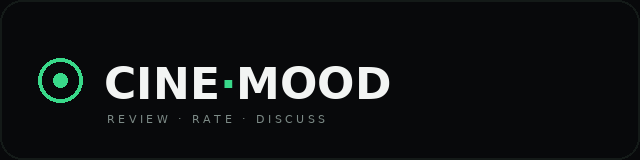
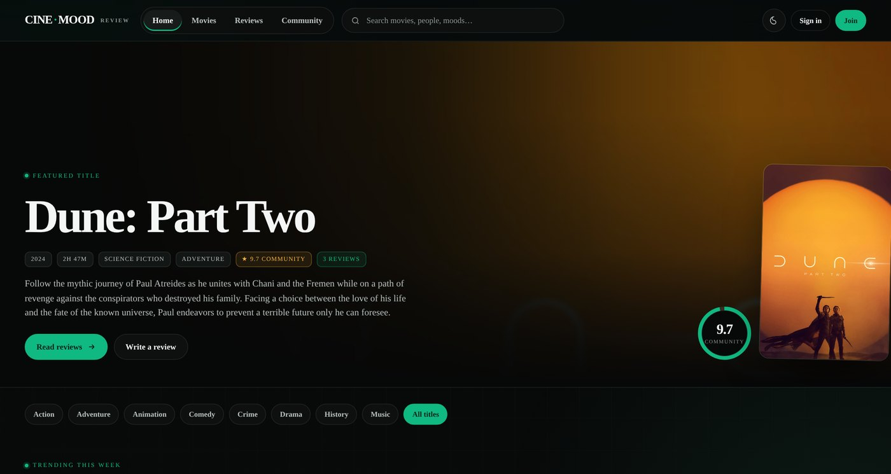
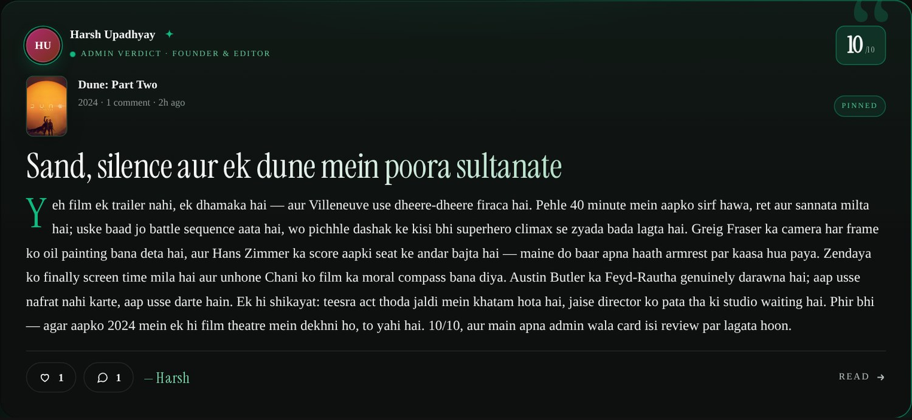
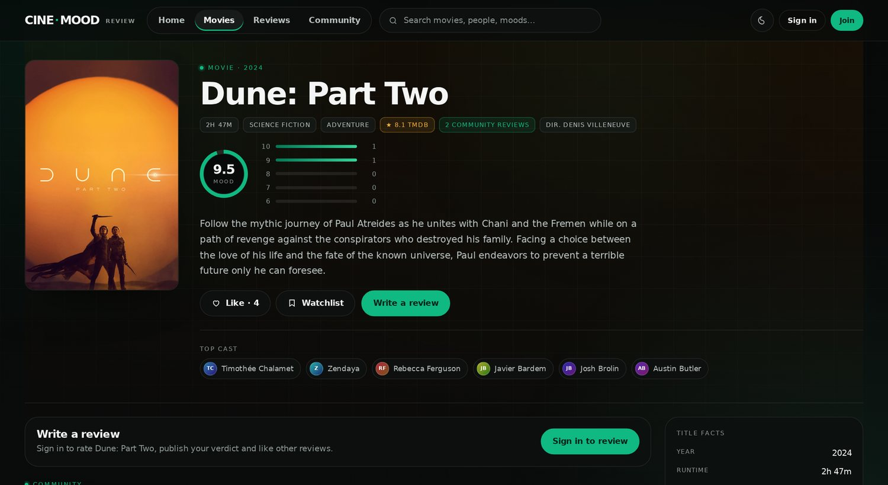
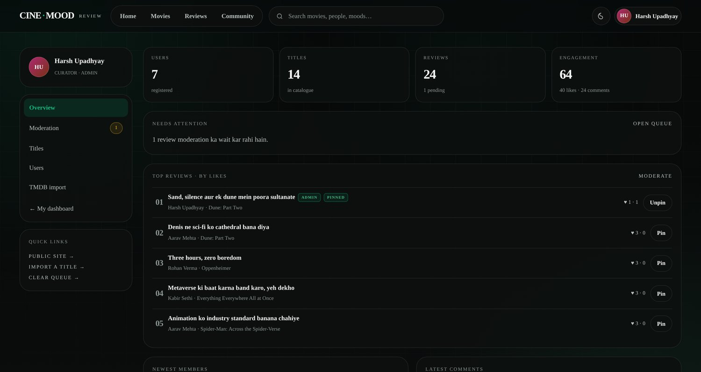
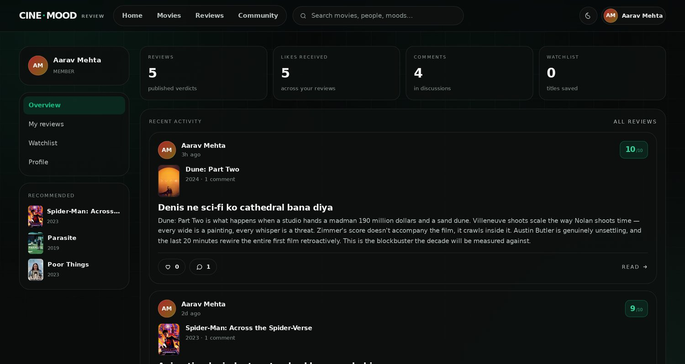
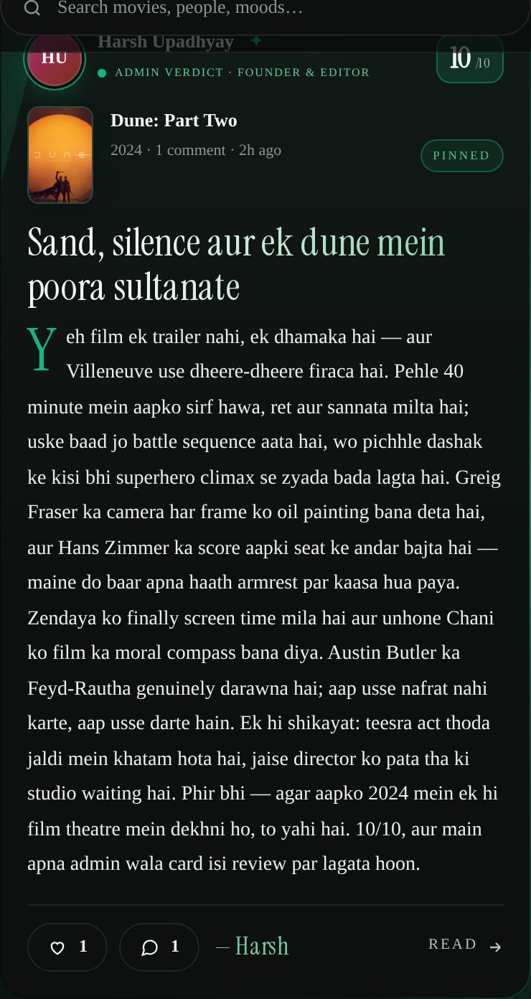

<div align="center">



### Community verdicts on cinema — reviews, not downloads.

[](https://nextjs.org)
[](https://react.dev)
[](https://typescriptlang.org)
[](https://prisma.io)
[](https://supabase.com)
[](https://authjs.dev)
[](https://themoviedb.org)

**[Live demo](https://cinemood.vercel.app)** · [Features](#-features) · [Screenshots](#-screenshots) · [Quick start](#-quick-start) · [Deploy](#-deploy)

</div>

---

## ⚡ What this is

A premium, dark-cinematic **film review platform**. Look and feel of a modern streaming site, but the product
is editorial + community: 10-point ratings, spoiler-safe reviews, likes, comment threads, watchlists, a member
dashboard and a real admin panel.

**No files. No mirrors. No download buttons.** Metadata comes from TMDB, the verdict comes from people.
That is a deliberate product decision — it keeps the site legal, advertiser-safe, and deployable on free tiers.

---

## ✨ Features

| Area | What you get |
| --- | --- |
| **Discovery** | Hero with featured poster + community score ring, genre chips, trending rail, top-rated / community-pulse / top-reviewer sidebars, new arrivals |
| **Catalogue** | Instant search (title, synopsis, director — case-insensitive), genre filter, sort by trending / rating / newest / title |
| **Film page** | Score ring, 10→6 rating distribution, cast, LIKE + WATCHLIST, review composer, review list, similar titles, JSON-LD |
| **Reviews** | 10-star picker, headline, body, spoiler blur-reveal, one review per user per film (upsert), likes, threaded comments |
| **Admin verdict** | Any review by an ADMIN gets a premium animated card — conic gradient border, Instrument Serif headline, drop cap, PINNED badge, signature |
| **Dashboard** | Stats (reviews, likes received, comments, watchlist), my reviews, watchlist, editable profile |
| **Admin panel** | KPIs, moderation (publish / hide / pin / delete), catalogue (feature / hide), members (role / delete), comments, TMDB import |
| **Auth** | Google OAuth + passwordless demo login, JWT sessions, role gating, **login required to like, comment and review** |
| **i18n** | One-click **English / हिंदी / Hinglish** switcher in the header (cookie-persisted) |
| **Design** | 5 accent themes (emerald, cyan, rose, violet, amber), real light mode, Instrument Serif display type, mobile-first at 390px |
| **SEO/PWA** | Sitemap, robots, OG image, manifest, per-film JSON-LD |

---

## 📸 Screenshots

### Home — hero, rails and community feed


### Admin verdict — the premium pinned review card


### Film detail — score ring, rating distribution, actions


### Admin panel — moderation, pinning, top reviews by likes


### Member dashboard


### Mobile (390px)


---

## 🧱 Stack

| Layer | Choice | Cost |
| --- | --- | --- |
| Framework | Next.js 15 App Router + React 19 + TypeScript | free |
| Styling | Hand-written design system (`app/globals.css`) — no UI kit, no Tailwind | free |
| Auth | Auth.js v5 — Google OAuth + demo email, JWT, role-based admin | free |
| Database | **Supabase Postgres** (dedicated `cinemood` schema) | free tier |
| ORM | Prisma 6 (`db push`, seed script included) | free |
| Metadata | **TMDB API** via server-side proxy (ISP-block safe) | free |
| Ratings | **OMDb** (IMDb / Rotten Tomatoes / Metacritic) — optional | free tier |
| Hosting | Vercel Hobby + Supabase + Cloudflare Worker (optional relay) | ₹0 |

---

## 🚀 Quick start

```bash
git clone https://github.com/Dev-Harshupadhyay/Cinenvood.git
cd Cinenvood
npm install
cp .env.example .env        # then fill the values below
npx prisma generate
npx prisma db push          # creates tables in the Postgres schema
node prisma/seed.mjs        # 7 users · 14 films · 24 reviews (1 pinned verdict)
npm run dev                 # http://localhost:3000
```

### Environment

```env
# Supabase — pooled (6543) for runtime, direct (5432) for migrations
DATABASE_URL="postgresql://postgres.<ref>:<pass>@aws-0-<region>.pooler.supabase.com:6543/postgres?schema=cinemood&pgbouncer=true&connection_limit=1&sslmode=require"
DIRECT_URL="postgresql://postgres.<ref>:<pass>@aws-0-<region>.pooler.supabase.com:5432/postgres?schema=cinemood&sslmode=require"

AUTH_SECRET="openssl rand -base64 32"
AUTH_TRUST_HOST="true"
NEXT_PUBLIC_SITE_URL="http://localhost:3000"
ADMIN_EMAIL="you@example.com"        # first login with this email becomes ADMIN

AUTH_GOOGLE_ID=""
AUTH_GOOGLE_SECRET=""
TMDB_API_KEY=""                      # v3 key or v4 read token — both auto-detected
OMDB_API_KEY=""                      # optional: IMDb / RT / Metacritic scores
```

### Demo logins (no password)

| Email | Role |
| --- | --- |
| `admin@cinemood.app` | **ADMIN** — admin panel, pinning, moderation |
| any other email | **MEMBER** — review, like, comment, watchlist |

---

## 🎬 TMDB: fetch real movies (and survive ISP blocks)

Posters, cast, synopsis and search all come from TMDB. Add `TMDB_API_KEY` and the admin panel's
**TMDB import** can pull any film into your database in one click.

**Problem:** in India, many ISPs block `api.themoviedb.org` / `image.tmdb.org`, so the site looks broken.

**Solution (built in):**

1. **Server-side only** — the browser never calls TMDB, and the key never reaches the client.
2. **Image relay** — posters are served through `/api/img?p=w500/abc.jpg`, which fetches upstream on the server.
3. **Optional relay** — if your server can't reach TMDB either, deploy a 15-line Cloudflare Worker and set:

```env
TMDB_PROXY_URL="https://your-worker.workers.dev"   # API relay
TMDB_IMG_PROXY="https://your-worker.workers.dev"   # image relay
```

```js
// Cloudflare Worker — paste & deploy (free plan is enough)
export default {
  async fetch(req) {
    const url = new URL(req.url);
    const target = url.searchParams.get('url')
      ? url.searchParams.get('url')
      : 'https://image.tmdb.org/t/p/' + decodeURIComponent(url.pathname.replace(/^\/img\//, ''));
    const r = await fetch(target, { headers: { accept: req.headers.get('accept') || '*/*' } });
    return new Response(r.body, { status: r.status, headers: { 'content-type': r.headers.get('content-type') || 'application/json', 'cache-control': 'public, max-age=86400' } });
  }
};
```

> Nothing to change in the app — set the env vars and restart.

---

## 🌐 Languages

Header switcher: **English · हिंदी · Hinglish** (cookie `cm-lang`, server-rendered, no flash).
Copy strings live in `lib/i18n.ts` — add a key there and it works everywhere.

---

## 🔐 Auth rules

- **Like, comment, review, watchlist → login required.** Anonymous visitors get a "Sign in with Google" CTA and are
  redirected back to the exact page after login (`/login?next=…`).
- Google button appears automatically once `AUTH_GOOGLE_ID` / `AUTH_GOOGLE_SECRET` exist; demo email login stays as a fallback.
- Admin actions are re-checked server-side on every request (`requireAdmin()`), never trusted from the UI.

---

## 🗄 Database

Supabase Postgres, isolated in its own **`cinemood`** schema (so an existing `public` schema is never touched).

```
User ──< Review ──< Comment
  │        │  └──< ReviewLike
  └──< TitleLike (LIKE | WATCHLIST)
Title ──< Review
```

`Review.featured` powers the pinned admin verdict. `Title.imdbId / rtRating / metascore / imdbVotes` are filled by
**Admin → Titles → Enrich** (needs `OMDB_API_KEY`).

---

## ☁️ Deploy (free)

1. **Supabase** → new project → copy pooled + direct connection strings (`schema=cinemood`).
2. **Vercel** → import this repo → add the env vars above → deploy. Build command is already
   `prisma generate && next build`.
3. Run `npx prisma db push && node prisma/seed.mjs` **once** against the production database (not in the build step).
4. Add your domain and update `NEXT_PUBLIC_SITE_URL` + the Google OAuth redirect URI:
   `https://your-domain/api/auth/callback/google`.

---

## 📁 Project structure

```
app/                pages + API routes (App Router)
  api/              9 route handlers: reviews, likes, comments, search, profile, admin, tmdb, img relay
components/         client components (header, search, composer, comments, admin bits)
lib/               prisma client, session helpers, queries, i18n, TMDB + OMDb clients
prisma/            schema, seed script, seed data
docs/              logo + screenshots used in this README
legacy-vite/       original Vite + Express version (kept for reference)
```

---

## ⚖️ Legal

Metadata and artwork belong to their owners (TMDB attribution). This product uses the TMDB API but is not
endorsed or certified by TMDB. User content is moderated. DMCA process and privacy notes: [`/legal`](./app/legal/page.tsx).

**No copyrighted media is hosted, streamed or linked here — by design.**

---

<div align="center">

Built by **[Harsh Upadhyay](https://github.com/Dev-Harshupadhyay)** · Reviews, not downloads.

</div>
