<div align="center">


### Community verdicts on cinema — reviews, not downloads.

[](https://nextjs.org)
[](https://react.dev)
[](https://typescriptlang.org)
[](https://prisma.io)
[](https://supabase.com)
[](https://authjs.dev)
[](https://themoviedb.org)

**[Live demo](https://cinemood.vercel.app)** · [Features](#-features) · [Screenshots](#-screenshots) · [Quick start](#-quick-start) · [Deploy](#-deploy)

</div>

---

## ⚡ What this is

A premium, dark-cinematic **film review platform**. Look and feel of a modern streaming site, but the product
is editorial + community: 10-point ratings, spoiler-safe reviews, likes, comment threads, watchlists, a member
dashboard and a real admin panel.

**No files. No mirrors. No download buttons.** Metadata comes from TMDB, the verdict comes from people.
That is a deliberate product decision — it keeps the site legal, advertiser-safe, and deployable on free tiers.

---

## ✨ Features

| Area | What you get |
| --- | --- |
| **Discovery** | Poster-first homepage with a featured title, genre chips, movie + TV-series poster rails, and no review-feed cards |
| **Catalogue** | 270 seeded films plus TMDB-imported films and TV series; poster, backdrops, cast, director, runtime, and TMDB scores. Filter by title type, genre, and trending / rating / newest / title |
| **Title page** | Movie and TV-series details, score ring, rating distribution, cast, LIKE + WATCHLIST, review composer, local community reviews, separate IMDb reviews, similar titles, JSON-LD |
| **Reviews** | 10-star picker, headline, body, spoiler blur-reveal, one review per user per film (upsert), likes, threaded comments |
| **Admin verdict** | Any review by an ADMIN gets a premium animated card — conic gradient border, Instrument Serif headline, drop cap, PINNED badge, signature |
| **Dashboard** | Stats (reviews, likes received, comments, watchlist), my reviews, watchlist, editable profile |
| **Admin panel** | Responsive control room: KPIs, moderation, catalogue, members, evidence-based Jarvis editorial summaries, TMDB import, YouTube trailer search, analytics and audit trail — password-only admin session |
| **Trailers** | On-demand YouTube trailer discovery by title + year, embeddable-result filtering, an in-page player and YouTube search fallback; saved English/Hindi links remain supported |
| **Jarvis** | Ask grounded movie questions, draft an editable review with explicit consent, or click **Jarvis Review** on a search result/title page to generate and cache a bilingual owner-style editorial review with a distinct Jarvis verdict score; no catalogue-wide batch generation; uses IMDbio title facts and available non-spoiler reviews |
| **Auth** | Google OAuth for members; separate `ADMIN_EMAIL` + `ADMIN_PASSWORD` sign-in at `/admin/login`; a Google session alone never grants admin access |
| **Guest mode** | Signed-out visitors get a `localStorage` guest id and **read-only** access — browse catalogue and read every review, no account created |
| **Rate limiting** | Two-layer (instance memory + shared Postgres counter) on search, admin pages/actions, sign-in, reviews, comments, likes and analytics beacons — 429 + `Retry-After`, no bypass flag |
| **Analytics** | Cookie-less first-party page views, 14-day chart, top pages/titles, devices, referrers, guests vs members, plus Vercel Analytics |
| **Search** | Debounced animated search, keyboard navigation, local catalogue + optional IMDbio movie/series discovery |
| **i18n** | One-click **English / हिंदी / Hinglish** switcher in the header (cookie-persisted) |
| **Design** | 5 accent themes (emerald, cyan, rose, violet, amber), real light mode, Instrument Serif display type, mobile-first at 390px |
| **SEO/PWA** | Dynamic sitemap, robots, OG image, manifest, JSON-LD (WebSite, Organization, Movie, TVSeries, Review, BreadcrumbList), canonical URLs |
| **Responsive** | One layout for desktop and mobile: bottom tab bar ≤900px, chip rails, scroll-contained tables, 0px horizontal overflow at 390px |

---

## 📸 Screenshots

> Round 6 ka full handover (9 pages, Hinglish, screenshots ke saath): **`docs/CineMood-Round6.pdf`** — stability fix, bilingual editions, premium review UI, cast photos, deploy reality, 7-din ka plan.
>
> Current Round 17 handover (Hinglish, updated screenshots, tests + deploy status): **`docs/CineMood-Round17-Handover.pdf`**.

### Home — poster-first discovery, no review feed
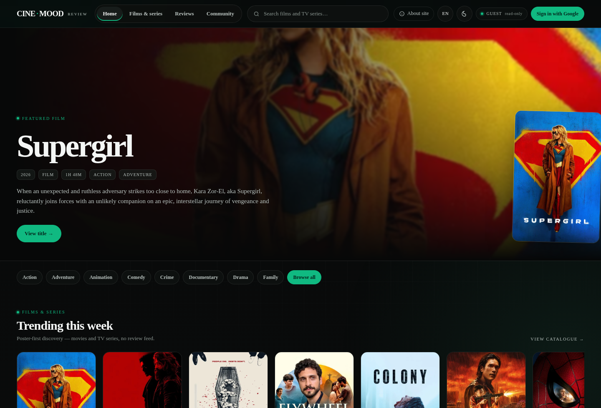

### Search — animated movie + TV-series suggestions
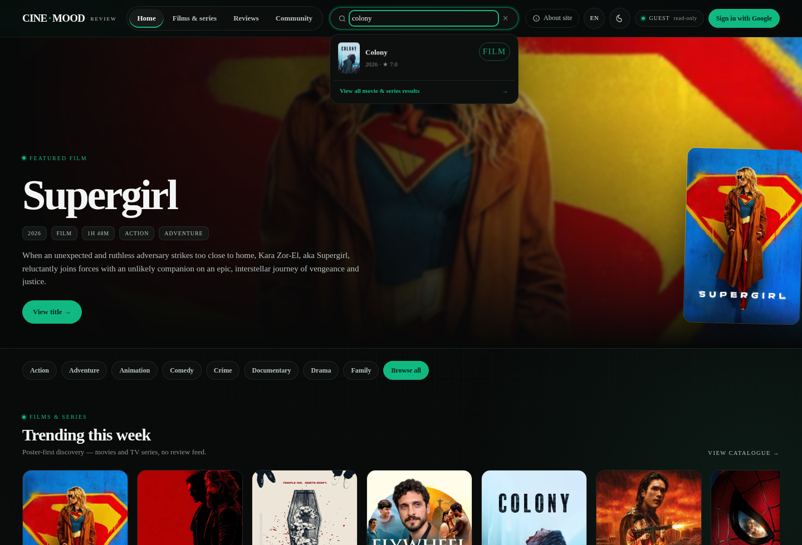

### Search — full results page
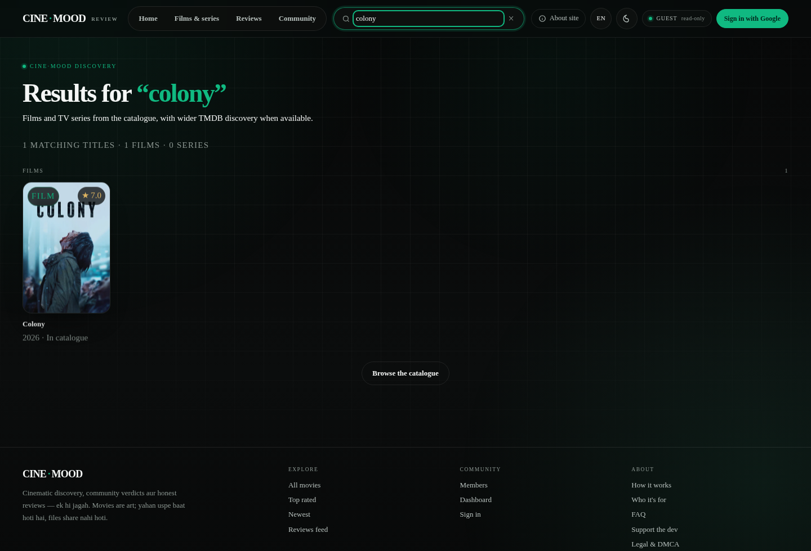

### Catalogue — 270 films, poster-first grid
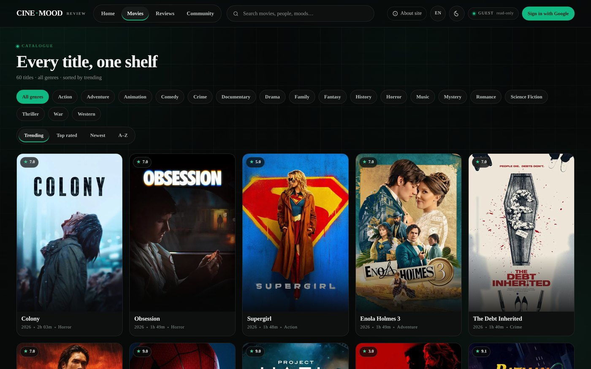

### Film detail — score ring, rating distribution, cast


### Legacy review — imported from the old app, credited to the site
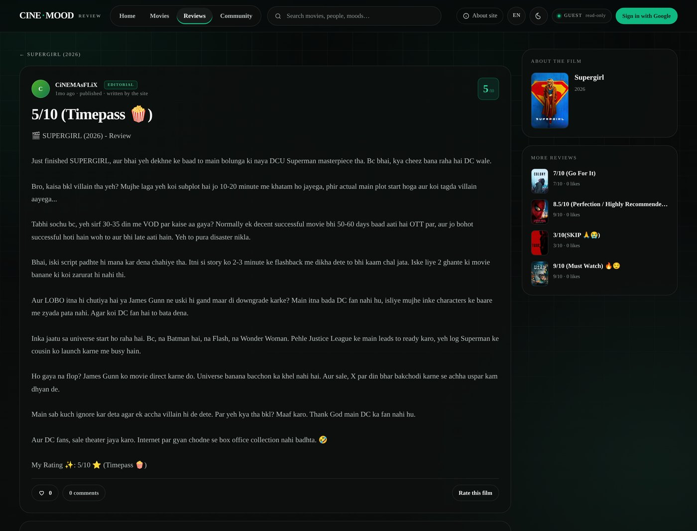

### Admin control room — KPIs, moderation, catalogue, logout
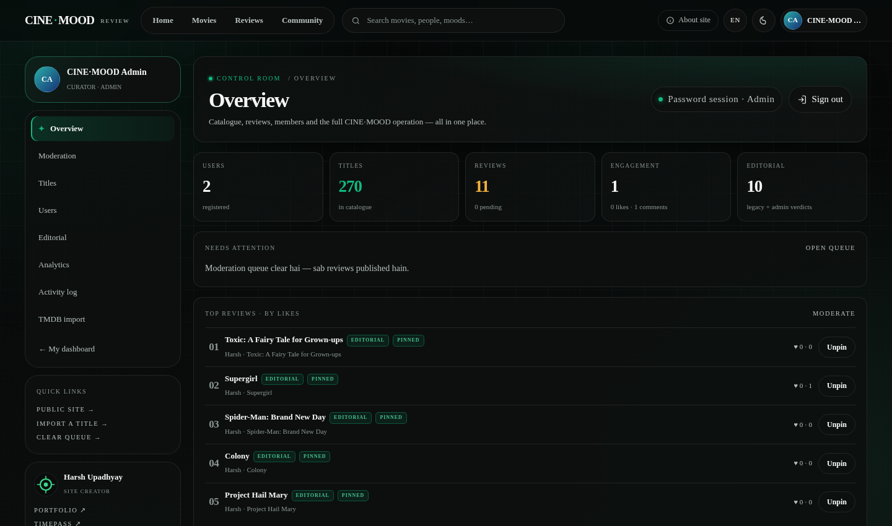

### Admin access — separate email + password; Google member login stays separate
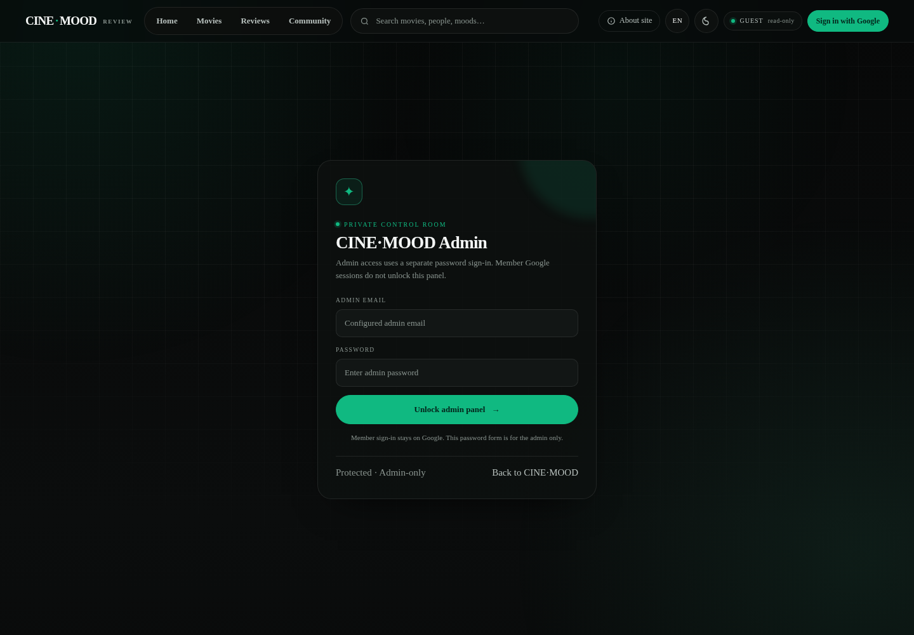

### Admin control room — mobile
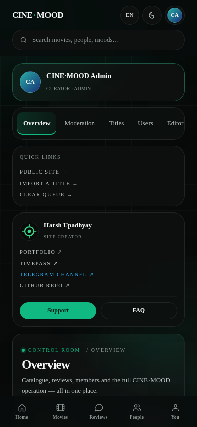

### Admin analytics — first-party, cookie-less traffic
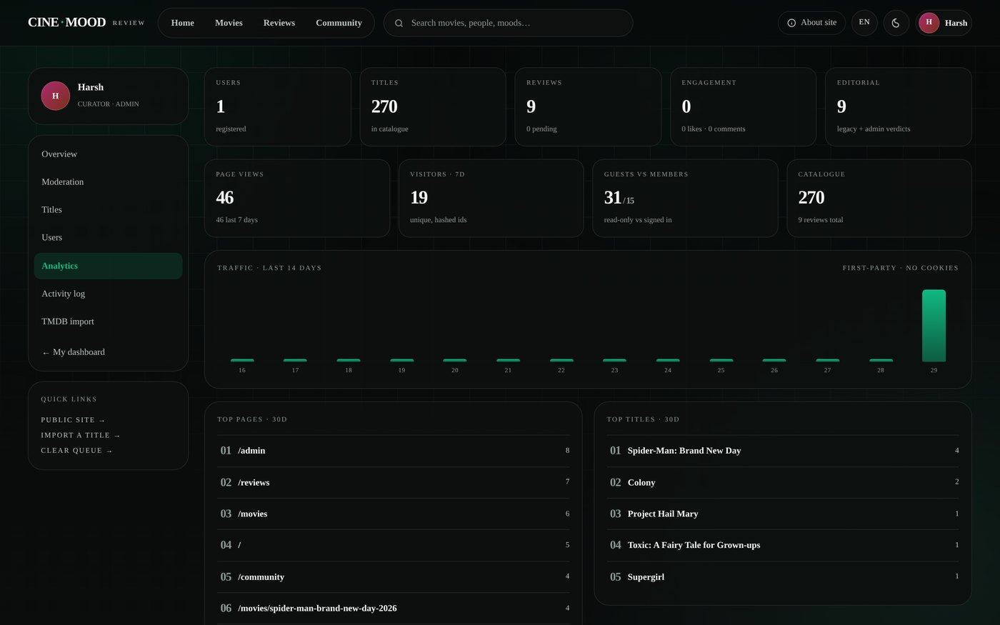

### Moderation — who said what, on which film, with how many likes
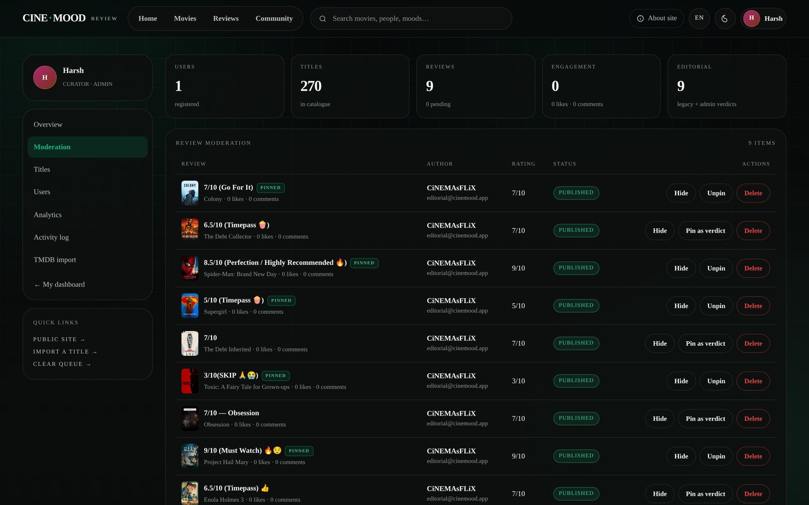

### Member dashboard


### Community — members, top reviewers, top verdicts
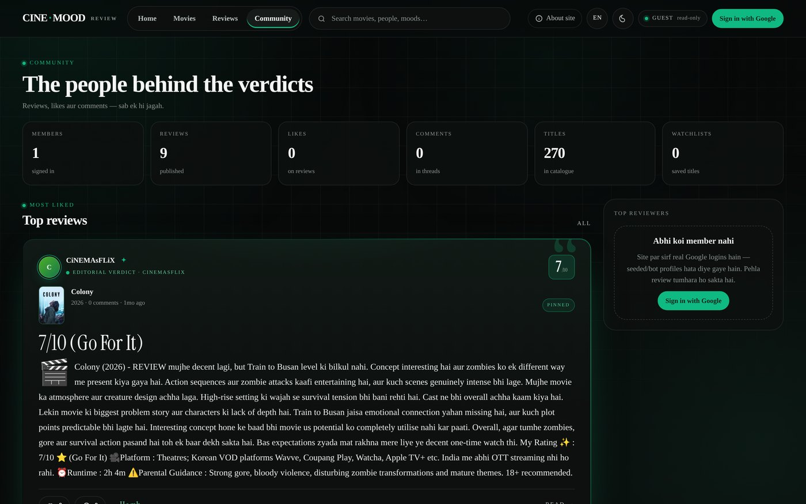

### Sign in — Google only, guest browsing underneath
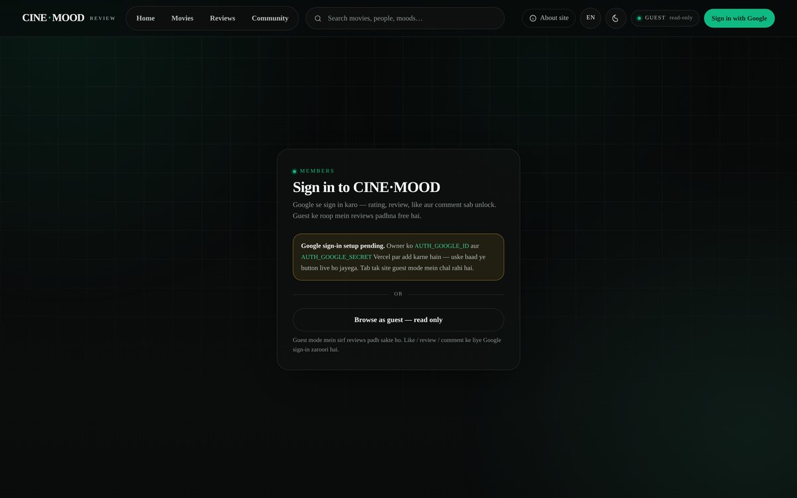

### Mobile — app-style bottom tabs and responsive search
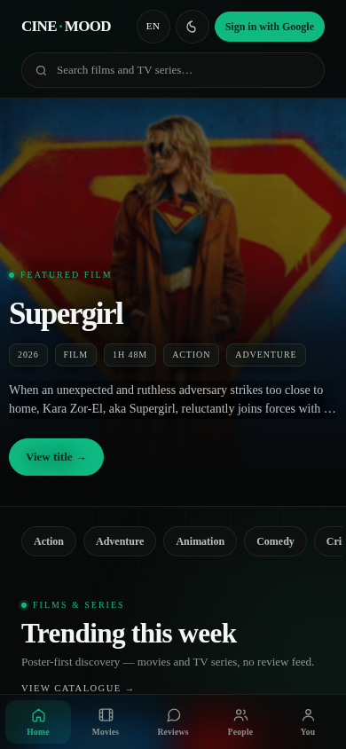 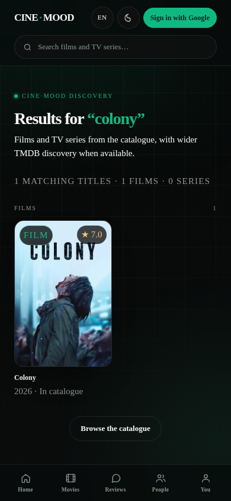 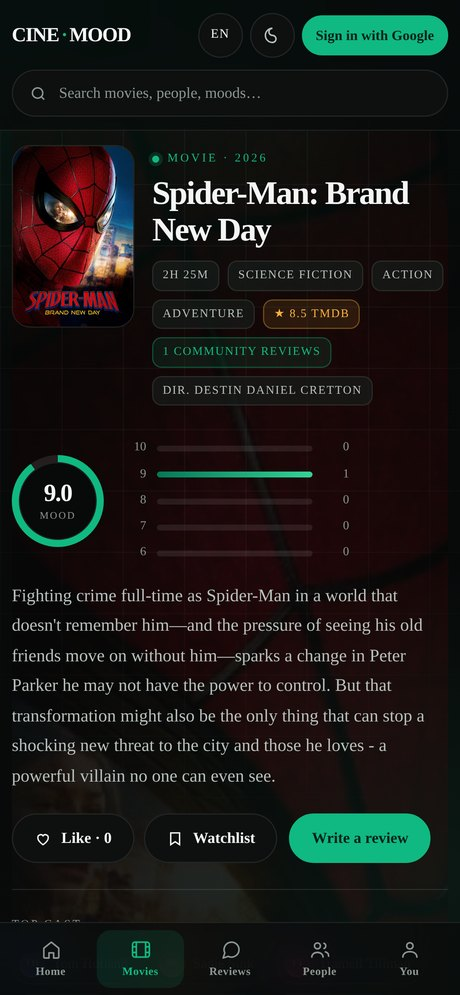 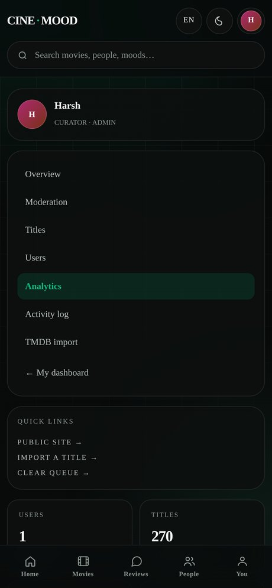

---

## 🧱 Stack

| Layer | Choice | Cost |
| --- | --- | --- |
| Framework | Next.js 15 App Router + React 19 + TypeScript | free |
| Styling | Hand-written design system (`app/globals.css`) — no UI kit, no Tailwind | free |
| Auth | Auth.js v5 — Google OAuth for members; password-only admin credentials, JWT sessions | free |
| Database | **Supabase Postgres** (dedicated `cinemood` schema) | free tier |
| ORM | Prisma 6 (`db push`, seed script included) | free |
| Metadata | **TMDB API** for the existing catalogue/imports; optional **IMDbio** FastAPI service for IMDb search/details | free tiers |
| Ratings | Live IMDbio rating; optional OMDb for IMDb / Rotten Tomatoes / Metacritic | free tiers |
| Hosting | Vercel + Supabase + Render IMDbio service; Cloudflare Worker relay optional | free tiers |

---

## 🚀 Quick start

```bash
git clone https://github.com/Dev-Harshupadhyay/Cinenvood.git
cd Cinenvood
npm install
cp .env.example .env        # then fill the values below
npx prisma generate
npx prisma db push          # creates tables in the Postgres schema
npm run db:import           # 270 real films + 9 legacy editorial reviews · 0 users
npm run dev                 # http://localhost:3000
```

### Environment

```env
# Supabase — pooled (6543) for runtime, direct (5432) for migrations
DATABASE_URL="postgresql://postgres.<ref>:<pass>@aws-0-<region>.pooler.supabase.com:6543/postgres?schema=cinemood&pgbouncer=true&connection_limit=10&sslmode=require"
DIRECT_URL="postgresql://postgres.<ref>:<pass>@aws-0-<region>.pooler.supabase.com:5432/postgres?schema=cinemood&sslmode=require"

AUTH_SECRET="openssl rand -base64 32"
AUTH_TRUST_HOST="true"
NEXT_PUBLIC_SITE_URL="http://localhost:3000"
ADMIN_EMAIL="you@example.com"        # the sole admin login email
ADMIN_PASSWORD=""                    # set a strong password; admin sign-in at /admin/login

AUTH_GOOGLE_ID=""                    # regular members
AUTH_GOOGLE_SECRET=""
TMDB_API_KEY=""                      # v3 key or v4 read token — both auto-detected
YOUTUBE_API_KEY=""                   # optional: YouTube Data API v3 trailer search
IMDBIO_API_URL=""                    # optional: Render FastAPI service URL
IMDBIO_API_TOKEN=""                  # same private token configured on Render
GEMINI_API_KEY=""                    # optional: Jarvis Q&A, cached public reviews, consent-gated drafts and translations
OMDB_API_KEY=""                      # optional: RT / Metacritic scores
```

### Signing in

There are **no seeded accounts** — a fresh database has zero users on purpose.

| Path | Behaviour |
| --- | --- |
| **Google member login** | Any Google account signs in as a regular member; can review, like, comment and use a personal dashboard. Google login never grants admin access. |
| **Admin password login** | `/admin/login` checks `ADMIN_EMAIL` + `ADMIN_PASSWORD`; only this credential session unlocks `/admin` and admin APIs. Password attempts are rate-limited. |
| **Local dev fallback** | Only when Google keys are missing **and** `NODE_ENV !== 'production'`, `/login` shows a local-only member test form. It is compiled out of production builds. |
| **Guest** | No login needed to read. A `cm-guest-id` lives in `localStorage`; like / review / comment redirect to `/login?next=…`. |

See [`docs/GOOGLE-AUTH-SETUP.md`](./docs/GOOGLE-AUTH-SETUP.md) for the six-click Google Cloud walkthrough.

See [`docs/ADMIN-SETUP.md`](./docs/ADMIN-SETUP.md) for Vercel environment setup, password-only admin access and YouTube trailer search.

## 🎬 TMDB: fetch real movies (and survive ISP blocks)

Posters, cast, synopsis and broad multi-search (movies + TV series) come from TMDB. Add `TMDB_API_KEY` and the admin panel's
**TMDB import** can pull a film or series into your database in one click.

**Problem:** in India, many ISPs block `api.themoviedb.org` / `image.tmdb.org`, so the site looks broken.

**Solution (built in):**

1. **Server-side only** — the browser never calls TMDB, and the key never reaches the client.
2. **Image relay** — posters are served through `/api/img?p=w500/abc.jpg`, which fetches upstream on the server.
3. **Optional relay** — if your server can't reach TMDB either, deploy a 15-line Cloudflare Worker and set:

```env
TMDB_PROXY_URL="https://your-worker.workers.dev"   # API relay
TMDB_IMG_PROXY="https://your-worker.workers.dev"   # image relay
```

```js
// Cloudflare Worker — paste & deploy (free plan is enough)
export default {
  async fetch(req) {
    const url = new URL(req.url);
    const target = url.searchParams.get('url')
      ? url.searchParams.get('url')
      : 'https://image.tmdb.org/t/p/' + decodeURIComponent(url.pathname.replace(/^\/img\//, ''));
    const r = await fetch(target, { headers: { accept: req.headers.get('accept') || '*/*' } });
    return new Response(r.body, { status: r.status, headers: { 'content-type': r.headers.get('content-type') || 'application/json', 'cache-control': 'public, max-age=86400' } });
  }
};
```

> Nothing to change in the app — set the env vars and restart.

---

## 🌐 Languages

Two independent layers:

1. **UI language** — header switcher: **English · हिंदी · Hinglish** (cookie `cm-lang`, server-rendered, no flash).
   Copy strings live in `lib/i18n.ts`.
2. **Review edition** — every editorial verdict exists twice: Hinglish (`headline`/`body`) and English
   (`headlineEn`/`bodyEn`). `lib/edition.ts` picks one per visitor:

   ```
   cookie cm-edition → x-vercel-ip-country → Accept-Language → default "en"
   ```

   India + neighbours (IN, NP, BD, PK, LK, AE, SG, MY) get **Hinglish**; the rest of the world gets **English**.
   The pill switch on `/reviews` and `/movies/[slug]` overrides the guess for a year (`cm-edition` cookie).
   Community reviews are always shown exactly as their author wrote them — no machine translation.

---

## 🔐 Auth rules

- **Like, comment, review, watchlist → login required.** Anonymous visitors get a "Sign in with Google" CTA and are
  redirected back to the exact page after login (`/login?next=…`).
- Google is the only production provider; the local email form exists solely for `next dev` and never ships.
- Admin access is decided by `email === ADMIN_EMAIL`, re-checked server-side on every request (`requireAdmin()`) and never trusted from the UI.
- Admin page loads and admin mutations are rate-limited (120/min and 60/min + 600/hour). Every mutation writes an `AdminLog` row.
- Denied admins land on `/admin-denied` which prints **their** email and the configured admin email — no guesswork.
- **Guest mode**: signed-out visitors keep a random `cm-guest-id` in `localStorage`, browse everything read-only and get a
  clear "sign in to react" note instead of a dead button. Never a user row, never a fake profile.
- **Editorial panel** (`/admin?tab=editorial`): publish/update/delete the site's own verdicts in both editions — no account needed,
  byline stays `Harsh · CiNEMAsFLiX`.

---

## 🗄 Database

Supabase Postgres, isolated in its own **`cinemood`** schema (so an existing `public` schema is never touched).

```
User ──< Review ──< Comment
  │        │  └──< ReviewLike
  └──< TitleLike (LIKE | WATCHLIST)
Title ──< Review
```

`Review.featured` powers the pinned admin verdict. `Review.userId` is **nullable**: legacy reviews imported from the old
app are `editorial = true` with an `authorName` byline, so they can be shown without inventing an account.
`Review.headlineEn` / `Review.bodyEn` hold the English edition; `Title.tmdbScore` keeps the TMDB score separate from the
community score; `Title.cast` is JSONB (`name`, `role`, `img`) rendered as the photo cast grid on film pages.
`Title.imdbId / rtRating / metascore / imdbVotes` are filled by **Admin → Titles → Enrich** (needs `OMDB_API_KEY`).

Support tables: `PageView` (first-party analytics), `RateLimit` (shared counters), `AdminLog` (audit trail).

---

## 🩺 Health & failure modes

- `GET /api/health` — checks every required env var, a real `SELECT 1`, the tables/columns the app needs, plus row counts.
  Returns **503** when anything is wrong, so uptime monitors and Vercel logs point straight at the cause.
- `/status` — the same report as a human-readable page (region, commit, missing vars, visible vs. hidden).
- `app/error.tsx` + `app/global-error.tsx` — a database blip renders a branded "temporary" card with a retry button instead
  of Next.js' red "Application error / server-side exception".
- `lib/safe.ts` — `settle()` / `settleAll()` degrade dangerous reads to empty data and show a yellow `DataBanner`
  ("live data thodi der ke liye unavailable") — the page still paints.
- `lib/prisma.ts` — retries once on transient pooler errors (`Connection reset by peer`, `P1001`, `P1017`) which are the
  usual cause of Supabase-pooler 500s on serverless.

---

## ☁️ Deploy (free)

1. **Supabase** → new project → copy pooled + direct connection strings (`schema=cinemood`).
2. **Vercel** → import this repo → add the env vars above → deploy. Build command is already
   `prisma generate && next build`.
3. Run `npx prisma db push && node prisma/import.mjs` **once** against the production database (not in the build step).
   `import.mjs` also applies `legacy-en.json` (English editions) and `cast-photos.json` (cast photos) when present.
4. Add your domain and update `NEXT_PUBLIC_SITE_URL` + the Google OAuth redirect URI:
   `https://your-domain/api/auth/callback/google`.

---

## 📁 Project structure

```
app/                pages + API routes (App Router)
  api/              9 route handlers: reviews, likes, comments, search, profile, admin, tmdb, img relay
components/         client components (header, search, composer, comments, admin bits)
lib/               prisma client, session helpers, queries, i18n, TMDB + OMDb clients
prisma/            schema, seed script, seed data
docs/              logo + screenshots used in this README
legacy-vite/       original Vite + Express version (kept for reference)
```

---

## ⚖️ Legal

Metadata and artwork belong to their owners. This product uses the TMDB API but is not endorsed or certified by TMDB; IMDb
metadata is accessed through the third-party IMDbio service and does not imply IMDb endorsement. User content is moderated.
DMCA process and privacy notes: [`/legal`](./app/legal/page.tsx).

**No full film or episode files are hosted or distributed. Trailer playback uses the official YouTube IFrame Player API.**

---

<div align="center">

Built by **[Harsh Upadhyay](https://github.com/Dev-Harshupadhyay)** · Reviews, not downloads.

</div>
